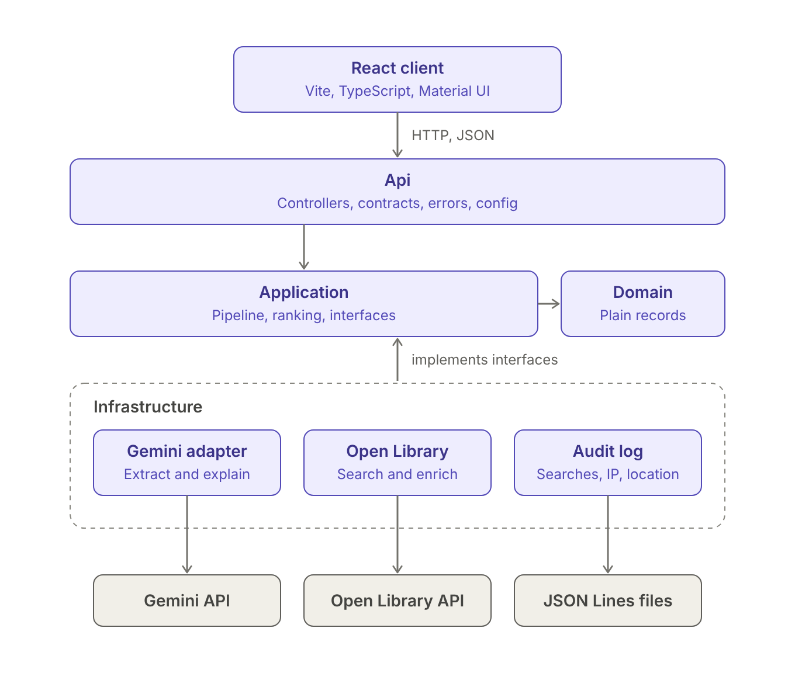

# Find That Book

## Stack
- **API:** ASP.NET Core on .NET 10 (.NET 8 was requested; .NET 10 is the current LTS and fully backward compatible with the requested design).
- **Client:** React 19 + TypeScript + Vite.
- **AI:** Google Gemini (the default).
- **Data:** Open Library Search / Works / Authors APIs.

## Project Requirements
The sections below follow the project's requirements, in order.

### Setup and running instructions

#### Prerequisites
You need two tools: the **.NET 10 SDK** (runs the API) and **Node.js 22.12 or newer** (runs the web app; the current LTS is recommended). You also need a free **Gemini API key** from https://ai.google.dev/gemini-api/docs/api-key.

**Windows** (PowerShell):
```powershell
winget install Microsoft.DotNet.SDK.10
winget install OpenJS.NodeJS.LTS
```

**macOS** (Homebrew):
```bash
brew install dotnet-sdk
brew install node
```

**Linux (Ubuntu/Debian):**
```bash
sudo apt-get update && sudo apt-get install -y dotnet-sdk-10.0
# Node.js: use the LTS installer from https://nodejs.org or a version manager such as nvm
# (the nodejs package in apt is often too old)
```

Prefer installers? Download them from https://dotnet.microsoft.com/download/dotnet/10.0 and https://nodejs.org.

Check that both work (open a new terminal first):
```bash
dotnet --version   # should print 10.0.x
node --version     # should print v22.12 or newer
```

#### Get the code
```bash
git clone https://github.com/TundraJake/find-that-book.git
cd find-that-book
```

#### Run it
The app runs as two processes, so use **two terminals**, each starting from the repo root: one for the API, one for the web app. Keep both running.

**Terminal 1, API:**
```bash
cd src/FindThatBook.Api
dotnet user-secrets set "Gemini:ApiKey" "<your-key>"
dotnet run                     # API on http://localhost:5080
```

**Terminal 2, web app:**
```bash
cd client
npm install
npm run dev                    # open http://localhost:5173
```

Without a Gemini key the API still starts; the page shows search as disabled, with the command to fix it.

#### Troubleshooting
- **Vite says Node.js is too old:** install Node.js 22.12 or newer (see Prerequisites), open a new terminal, and run `npm install` again.
- **The page says "Cannot reach the API":** make sure Terminal 1 is still running `dotnet run` on port 5080.

### Overview of the implementation


- **Pipeline (one search):** Gemini reads the messy query → Open Library is searched for candidates → candidates are ranked in plain C# → Gemini writes a "why it matched" sentence for each → the top 5 come back with the interpreted query.
- **AI for language, code for truth:** Gemini only interprets the query and writes explanations. Every book comes from Open Library, and the ranking is deterministic code, so results are reproducible and unit-tested.
- **Step 1, query extraction (Gemini):** returns `title`, `author`, `keywords`, `character_hints`, and `year_hint`, constrained by a JSON schema and validated again on the server (unknown fields, empty values, implausible years rejected).
- **Step 2, candidate search (Open Library):** up to four `search.json` queries run in parallel (title + author, title, author sorted by editions, character hints + author). The top works are then enriched with `/works/{id}.json` (canonical primary authors, subtitle, cover) and `/authors/{id}.json`. `/authors/{id}/works.json` confirms which results the queried author actually wrote.
- **Step 3, ranking (`CandidateRanker`):** each work gets a title match (exact / near / none) and an author match (primary / contributor / none), which place it in one of five match tiers (exact title + primary author → exact title + contributor → near title + author → author only → fallback). Ties are broken by closer title, primary author listed earlier, distance from the query's year, then edition count. Duplicate catalog records are merged first.
- **Step 4, explanations (Gemini):** one batched call writes a 1–2 sentence explanation per candidate from the fetched fields only, and also returns Gemini's own ranking (`ai_rank`). Explanations are checked for links, markup, code, and whether they mention the book.
- **Architecture:** four projects with dependencies pointing inward. `Domain` (plain records such as `BookCandidate`, `MatchTier`), `Application` (pipeline, ranking, interfaces such as `IQueryExtractor`), `Infrastructure` (Gemini and Open Library adapters, audit log), `Api` (controllers, contracts, error handling, configuration). The React client is the view, the controllers are thin, and the domain and contracts are the model.
- **Gemini resilience:** models are tried in order (`gemini-3.5-flash-lite`, then `gemini-3.1-flash-lite`) when one is out of quota. A "high demand" response retries the same model 3 times, 10 seconds apart. Thinking level `high`, safety settings on every call.
- **Open Library resilience:** responses are cached in memory, requests are throttled, merged works are followed through redirects, and a slow or failing query or lookup is skipped instead of failing the whole search.
- **Errors:** every failure is an RFC 7807 ProblemDetails response with a clear title: 400 invalid query, 422 rejected as unsafe, 429 daily or per-minute quota used up, 503 Gemini busy or Open Library not responding (with `source: "open_library"`), 502 any other upstream failure.
- **Configuration:** all limits, models, timeouts, and thresholds live in `appsettings.json` and are validated at startup. The Gemini key comes from user-secrets locally and an environment variable when deployed. The app starts without a key and the UI explains how to set it.

#### API JSON convention: snake_case
- Every API response uses snake_case, because the requested result format is written that way (`"first_publish_year": 1937`): property names, enum values (`"match_tier": "exact_title_primary_author"`), and error extras (`quota_scope`, `retry_after_seconds`, `trace_id`). Requests too (`work_key`, `primary_authors` on the diagnostics endpoint).
- Each candidate includes `author` (primary authors joined with ", ") to match the requested result format, plus `primary_authors` and `contributors` for the primary-vs-contributor distinction.
- Set once in `src/FindThatBook.Api/ApiJsonConventions.cs`. C# code stays PascalCase.

### Assumptions and design decisions

#### External providers: folders, not projects
- Each external integration (Gemini, Open Library) lives in its own folder under `FindThatBook.Infrastructure` (e.g. `Infrastructure/Gemini/`), with its own options, client, and mapped wire models.
- Chosen for simplicity at this application's size.
- At larger scale, each provider would be its own class library: the project boundary enforces isolation (`internal` types, no cross-provider calls) and keeps each provider's SDK dependencies separate.
- Providers share only the Application interfaces they implement (e.g. `IQueryExtractor`) and the domain shape they return; swapping in another provider (OpenAI, Claude, …) means adding a folder and changing one DI registration.
- As standalone projects, providers become reusable AI entry points for other applications: each caller passes the response format (JSON schema) it expects along with the request, so the same provider library serves different apps without changes to the library itself.
- Namespaces mirror a future project split (`FindThatBook.Infrastructure.Gemini`), so extracting a folder into its own project is a mechanical move.

#### Why React (with TypeScript) and not Blazor
- **It's part of my current stack:** I work in React and TypeScript today, so I could build the UI quickly and well. I've also built server-rendered front ends with ASP.NET MVC and Razor Pages, so the choice was about fit for this app, not the only option I know.
- **API-first:** the app calls for a modern UI backed by a .NET Web API. A separate React client uses the API the same way any other client would, through its JSON contract.
- **Full-stack range:** C# on the backend and TypeScript/React on the frontend.
- **Ecosystem and speed:** Material UI provided polished, accessible components, and Vite's instant reload made UI changes fast to try.
- **Interaction-heavy UI:** the resizable JSON inspector, cancel button, live usage counter, countdown notices, and client-side filter and sort are natural to build in React.
- **Simple hosting:** the React build is static files, served by the API in one container or from a CDN later, so the frontend and backend can be deployed separately.
- **Trade-offs with Blazor:**
  - Blazor's main advantage is C# end to end, with models shared directly between client and server. Here the TypeScript types mirror the API contract by hand; generating them from the OpenAPI document would close that gap.
  - Blazor Server keeps a live connection and UI state on the server for every user, which adds latency and server load for a public app.
  - Blazor WebAssembly downloads the .NET runtime on first visit, so the first load is slower than a small React bundle.
- **When I'd pick Blazor (or MVC/Razor):** internal business apps built by a C#-only team, or apps with a lot of validation and logic shared between client and server.

#### Open Library endpoints
| Endpoint | What it's used for |
|---|---|
| `/search.json` | Finds candidate books. Searched by title and author, by title alone (to catch adaptations and other editions), by author sorted by most editions (the author-only fallback), and by free text when the query names characters. The results are merged. |
| `/works/{id}.json` | One book's details: its real primary authors, subtitle, and cover. |
| `/authors/{id}.json` | An author's name when the search results did not include it. |
| `/authors/{id}/works.json` | The author's full list of works, used to confirm which results they actually wrote. |

- `/authors/{id}/works.json` lists works newest record first, not by popularity, so "top works by that author" comes from `search.json?author=…&sort=editions`. The works list is used to put works the queried author actually wrote ahead of ones where they are only mentioned, before the top results are enriched. Details: `docs/integrations/openlibrary/endpoints-and-quirks.md`.

#### Author link when the book isn't found
- When the query names an author who appears as a primary author in the results, the response includes `matched_author` (name and Open Library page). If no result is an exact title + primary author match, the UI shows "No exact match for "…", but we found the author" with a link to all their books.
- Contributors never trigger it, so the link always goes to someone who wrote the books.

#### Primary authors vs contributors
- Primary authors come from the canonical work record (`/works/{id}.json`); other names in search results' `author_name` are contributors.
- Open Library's work records sometimes list adaptors as authors too (e.g. the Dixon/Deming graphic-novel Hobbit), so ties within a tier are broken by the queried author's position, then edition count. Details: `docs/integrations/openlibrary/endpoints-and-quirks.md`.

#### Gemini only, no fallback
- Every query is interpreted by Gemini; there is no rule-based fallback or sample data. Gemini failures return a 502 with the reason.
- Without an API key the app still starts, reports `ready: false` at `GET /api/status`, and the UI disables search and shows how to fix it.

#### Gemini models and quotas
- `Gemini:Models` is an ordered list: `gemini-3.5-flash-lite` first, `gemini-3.1-flash-lite` as fallback. A quota error (429) retries the same request on the next model; other errors never fall back.
- An over-quota model is skipped until it resets (daily quota: midnight Pacific; per-minute: Google's `retryDelay`). Only when every model is out does the API return 429 with `quotaScope` (`daily`/`perMinute`), and the UI shows a "Daily usage limits reached, please come back tomorrow" notice.
- "High demand" (HTTP 503, model overloaded) never switches models, so results stay consistent: the same model is retried `Gemini:BusyRetryAttempts` (3) times, `Gemini:BusyRetryDelaySeconds` (10) apart. If it is still overloaded the API returns 503 with `retryAfterSeconds` (`Gemini:BusyRetrySeconds`, 5), and the UI shows a one-line notice with a countdown and a "Try again" button.
- `Gemini:ThinkingLevel` is `high` for both calls (accuracy over latency).

#### Ranking: deterministic by default, AI as an alternative view
- The list order is always the code-based match hierarchy (exact title + primary author first, …), so it is testable and explainable. That is the default "Best match first" sort.
- Gemini also ranks the candidates (`aiRank`, 1 = most likely) in the same call that writes the explanations, so it costs no extra quota. The UI offers it as an "AI ranking" sort option.
- Ranks must be exactly 1..N; otherwise `aiRank` is null for that search and the option is disabled. Explanations are unaffected.

#### Unsafe queries
- **Gemini safety settings** (`Gemini:SafetyCategories`, `Gemini:SafetyThreshold`) on every call: harassment, hate speech, sexually explicit, dangerous content, and jailbreak (prompt-injection) attempts, blocked at medium and above. Medium rather than low so real titles with dark themes (*In Cold Blood*, *American Psycho*) still work.
- **Explanation output checks**: every explanation must be plain text about its own book (it names the title or an author) with no links, markup, or code. Failing that usually means the query tried to steer the model.
- Either case returns **422** "This search can't be processed", the UI shows a neutral notice, and the audit log records outcome `rejected`.

#### Search audit log
- Every search is appended as one JSON line to `logs/search-audit/searches-YYYY-MM-DD.jsonl` (UTC date, relative to the API project; git-ignored) and echoed to the app log: time, request id, client IP, location (country, region, city, timezone), user agent, query, outcome (`succeeded`, `noResults`, `quotaExhausted`, `upstreamFailed`, `cancelled`, `failed`), result count, top result, failure reason, duration.
- Location comes only from Cloudflare's visitor location headers: no third-party lookups. Anything unknown (local runs, missing headers) is logged as `"Not available"`.
- Proxy headers are trusted only when `SearchAudit:TrustProxyHeaders` is true (set in deployment), since clients can forge them. The log contains IP addresses (personal data): keep retention short.

#### Gemini temperature
- Left at Google's default: recent Gemini models are tuned for it, and output predictability comes from the response schema plus server-side validation rather than temperature.

### Features implemented
- **Messy-query search:** one box for anything you remember (title, author, characters, year, edition words), up to 300 characters, with Enter to search, Shift+Enter for a new line, and Esc or a Cancel button to stop a search in progress.
- **What Gemini understood:** chips showing the title, author, characters, keywords, and year read from the query.
- **Ranked results (up to 5):** cover, title, primary authors, contributors, first publish year, a tier label (Best match, Title match · contributor, Close match, Same author, Possible match), the "why it matched" explanation, and a link to Open Library.
- **Filter and sort:** filter by match tier; sort by best match (default), AI ranking, newest, oldest, or title.
- **Author link:** when the author is found but the exact book isn't, a shortcut to all of the author's books on Open Library.
- **Example queries:** clickable examples, each with a note on what kind of messy query it demonstrates.
- **JSON inspector:** a resizable side panel with the full API response or the selected card's JSON, plus status code and response time.
- **Gemini usage counter:** requests in the last minute against the configured per-minute limit.
- **Clear notices instead of raw errors:** daily limit reached (come back tomorrow), Gemini busy (countdown and "Try again"), Open Library not responding ("Try again"), search rejected by the safety checks, Gemini not configured (with the command to fix it).
- **Safety:** Gemini safety settings (harassment, hate speech, sexually explicit, dangerous content, jailbreak attempts) and output checks on every explanation.
- **Search audit log:** every search written to a daily JSON Lines file and the app log, with time, client IP, approximate location (from Cloudflare headers when deployed, otherwise "Not available"), query, outcome, result count, top result, and duration.

### Testing strategy
- **Unit tests:** 135 xUnit tests (`tests/FindThatBook.UnitTests`) that need no network and no API key. They cover the ranking rules and tie-breakers, text normalization, title and author matching, Gemini request building and strict response validation, safety and explanation checks, quota fallback and high-demand retries, Open Library parsing and timeout handling, and the search audit log.
- **Real captured responses:** Open Library and Gemini behavior is tested against saved real responses (`tests/FindThatBook.UnitTests/Fixtures/`), including the data quirks that matter here: merged-work redirects, contributors mixed into `author_name`, and the graphic-novel Hobbit.
<!-- Add manual and verbal testing notes here. -->

### Future improvements
- **Genre and fiction / nonfiction filters:** let the reader narrow a search by genre and by fiction or nonfiction, using Gemini to read those hints from the query and Open Library subjects to filter and rank candidates, for a much more focused search.
- **Stronger Open Library error handling and a test suite for it:** Open Library's search is often slow or briefly unavailable (searches have taken 20–60 seconds, and some time out). Today a slow query or lookup is skipped, and a total failure shows a "Try again" notice. Next: cache search results so repeat queries skip Open Library, retry a timed-out request once with backoff, add a circuit breaker so the app stops calling Open Library during an outage, and build a dedicated test suite (simulated timeouts, partial failures, malformed responses, outages) to cover all of it.
- **Faster search times:** a typical search takes about 10–35 seconds, mostly waiting on Gemini and Open Library. Options to investigate: cached results, fewer or smaller Open Library calls, a lower Gemini thinking level for the explanation step, and streaming results to the page as each step finishes.
- **More AI models, with a model picker:** support other providers and models (for example OpenAI, Claude, or other Gemini tiers) behind the existing `IQueryExtractor` / `IExplanationWriter` interfaces, and add a drop-down to choose one. Each option would carry a plain-language description (e.g. "fastest", "most accurate", "free tier") and a technical one (model ID, cost, rate limits, latency). Needs research into which models suit this task and how they compare.
- **Popular-books banner while waiting:** a search can take up to a minute, so in place of only a loading skeleton, show a rotating banner of popular or trending books (covers, titles, a one-line hook) from Open Library's trending data or another book source. It makes the wait visibly active and gives readers something to browse. Needs research into the data source, caching, and making sure it never slows the search itself.
- **Faster author-only searches (e.g. `tolkien`, `dickens`):** an author-only query runs a single Open Library search, the author's books sorted by most editions. Open Library is slow to sort a prolific author's whole catalog: these searches took 20–30 seconds, and `tolkein` timed out three times in a row at the 15-second limit. With only one search running there is nothing to fall back on, so the whole search fails. Fix to implement: run a plain, unsorted author search alongside the sorted one as a backup (the ranking already orders by edition count), and test author-only queries specifically.
- **Frontend tests and code quality:** add end-to-end Playwright tests and component tests for the single-page app, and tighten frontend code-quality controls (simpler search-state handling, theme-only colors, stricter lint rules).
- **Paid AI tier with controlled usage:** move to a paid Gemini tier (or another paid model) so the free tier's daily and per-minute limits stop blocking searches, and keep costs under control with usage rules: a small free allowance for anonymous public visitors, higher limits for signed-in accounts, per-user and per-IP rate limiting, and spending caps with usage monitoring.
<!-- Add more future improvements here. -->
